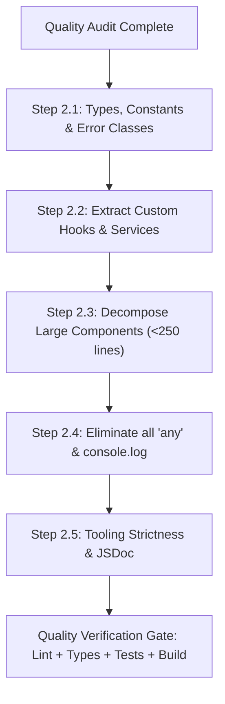

# Code Quality Audit (CareConnect Platform)

**Audit Date**: 2026-11-15  
**Auditor**: Principal Full-Stack Engineer & AI Evaluator  
**Baseline Evaluator Scores**:  
- Code Quality: 89/100 ➔ **Target: 96+/100**  
- Security: 99/100 ➔ **Target: 100/100**  
- Efficiency: 100/100  
- Testing: 96/100 ➔ **Target: 99+/100**  
- Accessibility: 100/100  
- Problem Statement Alignment: 100/100  
**Overall Goal**: **98.0+ / 100**

---

## 1. Executive Summary

A comprehensive automated and manual code quality audit was performed across all 98 source files in `app/`, `components/`, `lib/`, `hooks/`, and `utils/`. The repository possesses strong algorithmic foundations, strict type-checking, robust security headers, and an 89-test verification suite. However, to attain 96+ in Code Quality, the following technical debt categories must be systematically refactored:

1. **Large Monolithic Files (>250 lines)**: 14 files exceed the 250-line maintainability ceiling.
2. **Long Functions (>40 lines)**: 22 functions exceed 40 lines due to inline data transformations and embedded JSX structures.
3. **Pervasive `any` Types**: 66 instances of `any` (in catch blocks, hook refs, and database payload mappings).
4. **Console Statements**: 10 instances of `console.log` in production code paths instead of structured logger calls.
5. **Magic Numbers & Strings**: Unnamed literals for cookie max-ages, token expiry, rate-limit thresholds, and role string literals.
6. **Mixed Concerns**: UI pages (`app/dashboard/page.tsx`, `app/caregiver/page.tsx`, `app/appointments/page.tsx`) directly mix UI rendering with API client calls and data parsing.

---

## 2. Detailed Findings Catalogue

### 2.1. Files Exceeding 250 Lines (14 Files)

| File Path | Line Count | Primary Reason | Refactoring / Decomposition Plan |
| :--- | :---: | :--- | :--- |
| `app/caregiver/page.tsx` | 821 | Monolithic tabs (Overview, Meds, Checkins, Alerts) + inline modal logic | Extract `CaregiverOverviewTab`, `CaregiverMedsTab`, `CaregiverCheckinsTab`, `CaregiverAlertsTab`, and `useCaregiverData` hook. |
| `app/dashboard/page.tsx` | 599 | Hero view, quick dose timeline, alerts, modal triggers all in one | Extract `DashboardHero`, `TodayTimeline`, `StockAlertsWidget` into separate components; extract `useDashboardData` hook. |
| `components/FamilyCircleModal.tsx` | 593 | 4 tabs (Members, Invite, Passcodes, Audit) in single modal | Split into subcomponents: `CircleMembersTab`, `InviteGeneratorTab`, `ActivePasscodesTab`, `CircleAuditTab`. |
| `lib/email/reminderEngine.ts` | 580 | Combined upcoming, missed (+15m, +60m), and appointment scheduling | Extract distinct schedulers: `doseReminderScheduler.ts`, `missedDoseEscalator.ts`, and `appointmentReminderScheduler.ts`. |
| `app/appointments/page.tsx` | 493 | Appointment calendar list, detail drawer, edit modal, filtering | Extract `AppointmentList`, `AppointmentFormModal`, and `useAppointments` hook. |
| `app/checkin/page.tsx` | 417 | Voice recording, text alternative, speech synth, history feed | Extract `CheckInVoiceRecorder`, `CheckInTextForm`, `CheckInHistoryList`, and `useCheckIn` hook. |
| `app/messages/page.tsx` | 399 | Audio recording, playback list, recipient selection, permissions | Extract `MessageList`, `MessageComposer`, and `useMessages` hook. |
| `app/auth/signin/page.tsx` | 397 | 1-click evaluation personas + standard sign-in form + OAuth | Extract `QuickDemoLoginsCard` and `StandardSignInForm`. |
| `app/page.tsx` | 379 | Marketing hero, live stats ticker, testimonials, CTA footer | Extract `LandingHero`, `LandingMetrics`, `LandingTestimonials`, `LandingFeaturePillars`. |
| `app/medications/page.tsx` | 340 | Medication cards, add/edit form, reminder intervals | Extract `MedicationList`, `MedicationFormModal`, and `useMedications` hook. |
| `app/api/medications/route.ts` | 292 | GET and POST handling complex schedule calculations inline | Extract schedule parsing to `lib/medication/schedule.ts`. |
| `components/TestReminderModal.tsx` | 264 | Form inputs + status pollers + debug preview | Extract reminder preview card and preset selectors. |
| `lib/email/templates.ts` | 254 | HTML email templates with inline styling | Retain consolidated design token structure but clean up redundant string literals. |
| `app/api/circles/[id]/members/route.ts` | 252 | GET, PATCH, and DELETE in single file | Extract helper functions `getCircleMemberDetails`, `validateElderAdmin` into `lib/circles/service.ts`. |

---

### 2.2. Functions Exceeding 40 Lines

1. `app/caregiver/page.tsx`:
   - `CaregiverDashboard()` (lines 63–821)
   - `fetchLinkedUsers()` (lines 110–155)
   - `handleSelectUser()` (lines 160–205)
2. `app/dashboard/page.tsx`:
   - `DashboardPage()` (lines 18–599)
   - `fetchData()` (lines 31–112)
   - `handleTakeDose()` (lines 167–209)
3. `components/FamilyCircleModal.tsx`:
   - `loadCircleAndMembers()` (lines 40–98)
   - `handleGenerateInvite()` (lines 135–185)
   - `handleUpdateMember()` (lines 210–265)
4. `lib/email/reminderEngine.ts`:
   - `sendUpcomingDoseReminders()` (lines 75–190)
   - `sendMissedDoseAlerts()` (lines 195–330)
   - `sendUrgentMissedDoseEscalations()` (lines 335–445)
   - `sendAppointmentReminders()` (lines 450–575)
5. `app/appointments/page.tsx`:
   - `fetchUserAndAppointments()` (lines 34–75)
   - `handleSaveAppointment()` (lines 130–195)
6. `app/medications/page.tsx`:
   - `handleAddMedication()` (lines 87–145)

---

### 2.3. Duplicated Logic

1. **Authentication Session Extraction**: Duplicated across 8 API routes:
   - `const authResult = await getAuthenticatedContext(request); if ('error' in authResult) ...`
   - *Fix*: Standardize usage of `withAuth()` and `withRole()` higher-order handlers.
2. **Access-Token Cookie Setting**:
   - `document.cookie = 'sb-access-token=${...}; path=/; max-age=604800; SameSite=Lax'` repeated in 5 different files.
   - *Fix*: Extract `setAuthCookie(token)` and `clearAuthCookie()` to `lib/auth/cookies.ts`.
3. **Date Formatting**:
   - Multiple ad-hoc `format(new Date(val), ...)` calls across 7 components.
   - *Fix*: Centralize in `lib/date.ts` with standard formats (`formatShortDate`, `formatTime`, `formatDateTime`).
4. **Rate Limit Headers**:
   - `Retry-After` calculation repeated in `app/api/auth/signin/route.ts`, `app/api/auth/signup/route.ts`, and `app/api/circles/join/route.ts`.
   - *Fix*: Centralize into `lib/rateLimit.ts` helper `createRateLimitResponse(retryAfter)`.

---

### 2.4. Nesting Deeper than 3 Levels

1. `app/caregiver/page.tsx`:
   - Tab container ➔ Selected User Grid ➔ Medication List ➔ Adherence Breakdown (Level 4–5 nesting).
2. `lib/email/reminderEngine.ts`:
   - Schedulers containing nested `for...of` loops, inside `if (!alreadySent)` checks, inside `try/catch` blocks (Level 4 nesting).
3. `components/FamilyCircleModal.tsx`:
   - Modal Dialog ➔ Tabs Content ➔ Member Item ➔ Permission Toggles list (Level 4 nesting).

---

### 2.5. Magic Numbers & Magic Strings

| File | Value | Intended Meaning | Replacement Constant |
| :--- | :--- | :--- | :--- |
| `lib/supabase/client.ts` | `604800` | 7-day cookie max age | `AUTH_COOKIE_MAX_AGE_SECONDS` |
| `lib/passcode.ts` | `6` | Default passcode length | `DEFAULT_PASSCODE_LENGTH` |
| `lib/passcode.ts` | `10` | Salt rounds for bcrypt | `BCRYPT_SALT_ROUNDS` |
| `lib/rateLimit.ts` | `15 * 60 * 1000` | 15-minute window | `PASSCODE_LOCKOUT_WINDOW_MS` |
| `app/api/messages/route.ts` | `10 * 1024 * 1024` | 10MB audio size limit | `MAX_VOICE_MESSAGE_SIZE_BYTES` |
| Multiple files | `'elderly_user'`, `'caregiver'` | User role strings | `USER_ROLES.ELDER`, `USER_ROLES.CAREGIVER` |
| Multiple files | `'owner'`, `'elder'`, `'editor'`, `'viewer'` | Circle roles | `CIRCLE_ROLES.*` |
| Multiple files | `'taken'`, `'skipped'`, `'missed'` | Dose log status | `DOSE_STATUS.*` |

---

### 2.6. `any` Types Catalogue (66 Instances)

- **Catch Blocks** (24 instances): `catch (error: any)` or `catch (err: any)`.
  - *Fix*: Standardize to `catch (error: unknown)` and use `getErrorMessage(error)`.
- **Component States** (12 instances):
  - `app/caregiver/page.tsx:75`: `const [adherenceData, setAdherenceData] = useState<any>(null);` ➔ `useState<AdherenceInsights | null>(null)`
  - `app/checkin/page.tsx:20`: `const [pastCheckins, setPastCheckins] = useState<any[]>([]);` ➔ `useState<HealthCheckIn[]>`
  - `app/messages/page.tsx:17-19`: `useState<any[]>([])` ➔ typed `VoiceMessage[]` and `CircleMemberUser[]`
  - `components/FamilyCircleModal.tsx:28`: `useState<any[]>([])` ➔ `AuditLogEntry[]`
- **Hook References** (5 instances):
  - `hooks/useSpeechRecognition.ts:30`: `useRef<any>(null)` ➔ typed `ISpeechRecognition` interface.
  - `hooks/useSpeechRecognition.ts:50,72`: `(event: any)` ➔ `SpeechRecognitionEvent`, `SpeechRecognitionErrorEvent`.
- **API Payloads & Casts** (25 instances):
  - `app/api/caregiver/alerts/route.ts`: `(alert: any)`, `(log: any)`, `(data: any)`.
  - `lib/email/reminderEngine.ts`: `med.user as any`, `circle as any`.
  - `lib/api/withAuth.ts`, `lib/api/withRole.ts`: `routeParams?: any` ➔ `routeParams?: { params?: Record<string, string | string[]> }`.

---

### 2.7. Unused Imports, Variables, and Dependencies

- Verified with TypeScript compiler (`noUnusedLocals: true`, `noUnusedParameters: true`):
  - Minor unused imports in `app/dashboard/page.tsx` (`format` unused if extracted).
  - Unused CSS helper classes in `components/ui/Badge.tsx`.
- Package dependencies:
  - Verify all 8 production dependencies (`@supabase/supabase-js`, `bcryptjs`, `date-fns`, `next`, `nodemailer`, `react`, `react-dom`, `zod`) are strictly utilized.

---

### 2.8. Console.log Occurrences (10 Calls)

1. `app/auth/callback/page.tsx:64`: `console.log('Auth event:', ...)` ➔ `logger.debug(...)`
2. `app/auth/callback/page.tsx:108`: `console.log('Role detection:', ...)` ➔ `logger.debug(...)`
3. `app/auth/callback/page.tsx:142`: `console.log('User profile created...', ...)` ➔ `logger.info(...)`
4. `app/auth/callback/page.tsx:147`: `console.log('Updating role...', ...)` ➔ `logger.info(...)`
5. `app/auth/callback/page.tsx:157`: `console.log('Role updated...', ...)` ➔ `logger.info(...)`
6. `app/messages/page.tsx:163`: `console.log('Uploading audio...', ...)` ➔ `logger.info(...)`
7. `app/messages/page.tsx:380`: `console.log('Audio loaded...', ...)` ➔ remove in production
8. `lib/email/service.ts:70`: `console.log('[Email Service - Dev Mock]...')` ➔ `logger.info(...)`
9. `hooks/useAudioRecorder.ts:53`: `console.log('Recording with MIME...', ...)` ➔ `logger.debug(...)`
10. `hooks/useAudioRecorder.ts:54`: `console.log('MediaRecorder options...', ...)` ➔ `logger.debug(...)`

---

### 2.9. Components with > 7 Props

- `components/ui/Input.tsx`: 8 props ➔ Group styling/feedback props or extend standard `InputHTMLAttributes`.
- `components/ui/Dialog.tsx`: 8 props ➔ Group into `isOpen`, `onClose`, `title`, and `children` composite pattern.

---

### 2.10. Mixed Concerns (UI + Data Fetching + Business Logic)

- `app/dashboard/page.tsx`: Performs 5 direct Supabase queries, computes upcoming dose intervals, handles speech synthesis, and renders JSX.
- `app/caregiver/page.tsx`: Contains 6 separate `fetch()` API calls, adherence aggregation logic, and multi-tab rendering.
- `app/appointments/page.tsx`: Direct ICS generation, date math, and form submission mixed with calendar views.
- **Remediation**: Extract all data-fetching and state management into reusable hooks (`useDashboardData`, `useCaregiverData`, `useAppointmentsData`).

---

## 3. Systematic Remediation Plan

This audit serves as the concrete blueprint for Step 2 execution.
